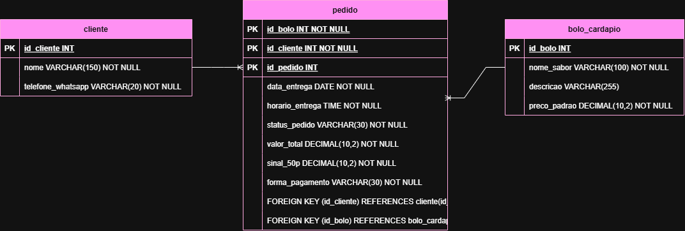

# Dona Neide — Bolos da Neide  Cliente: Dona Neide (Confeitaria Artesanal).  
Objetivo: Organizar as encomendas de bolos com cadastro simplificado, seleção a partir de um cardápio fixo, destaque para a data e horário de retirada e notificação direta ao cliente quando o bolo estiver pronto.
# Mer
cliente
- id_cliente PK
- nome VARCHAR(150)
- telefone_whatsapp VARCHAR(20)

bolo_cardapio
- id_bolo PK
- nome_sabor VARCHAR(100)
- descricao VARCHAR(255)
- preco_padrao DECIMAL(10,2)

pedido
- id_pedido PK
- id_cliente FK
- id_bolo FK
- data_entrega DATE
- horario_entrega TIME
- status_pedido VARCHAR(30)
- valor_total DECIMAL(10,2)
- sinal_50p DECIMAL(10,2)
- forma_pagamento VARCHAR(30)

relacionamento
- 1 cliente para varios pedido
- 1 bolo_cardapio para varios pedido
# Der 
